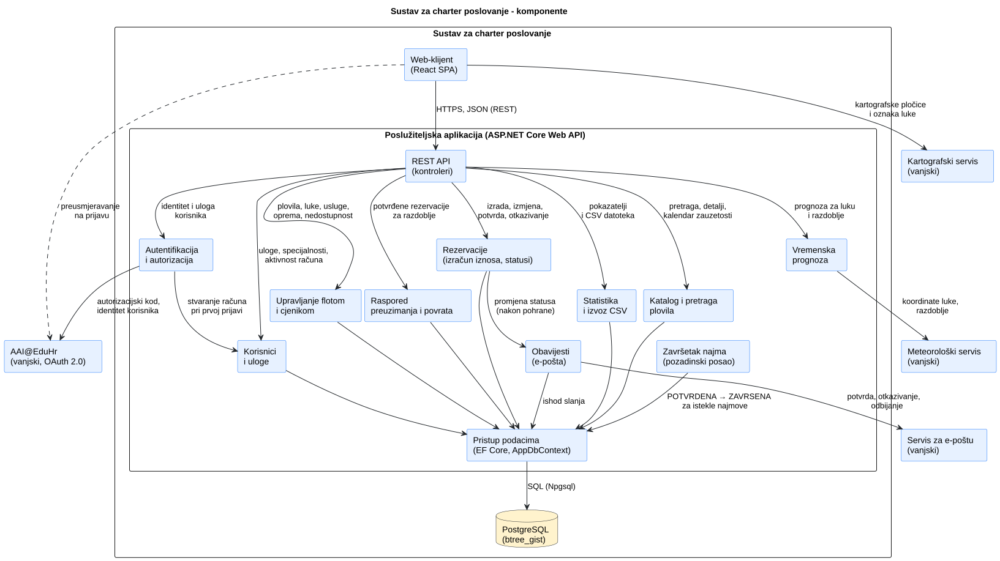
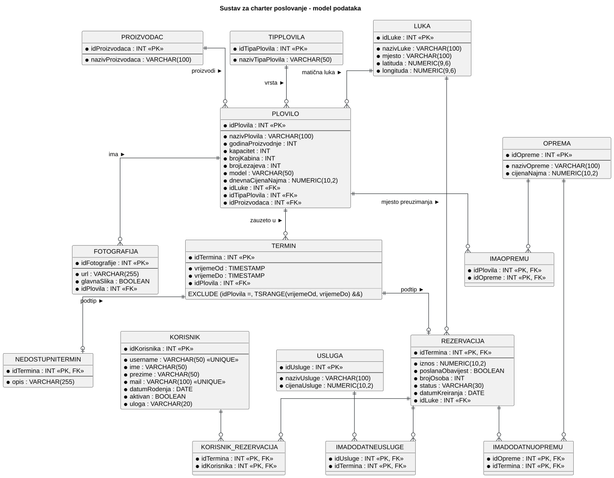
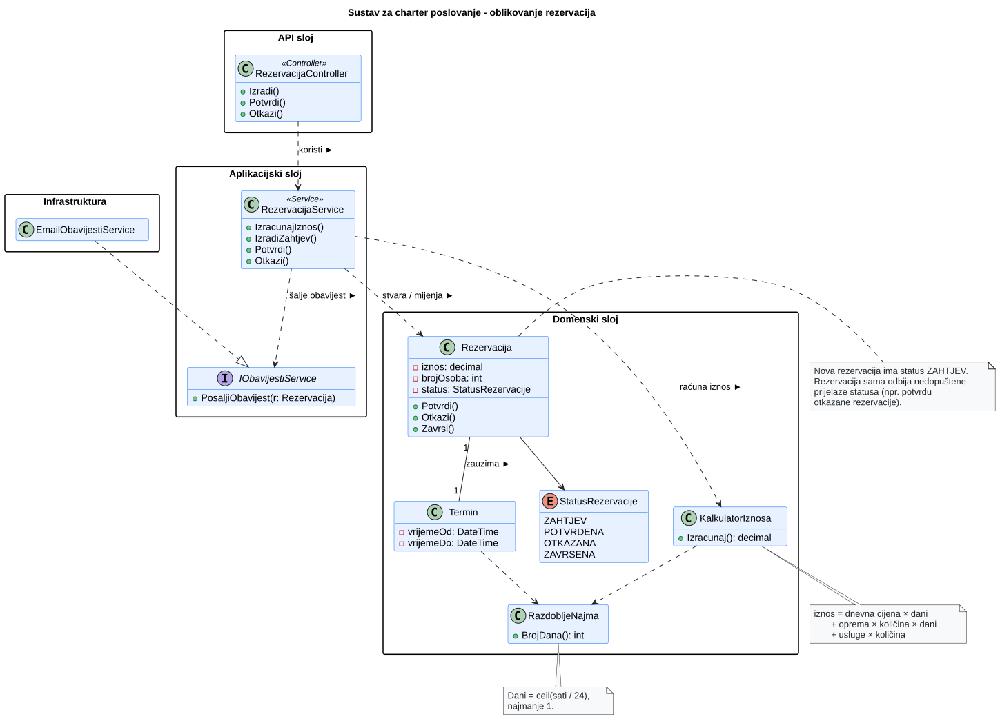
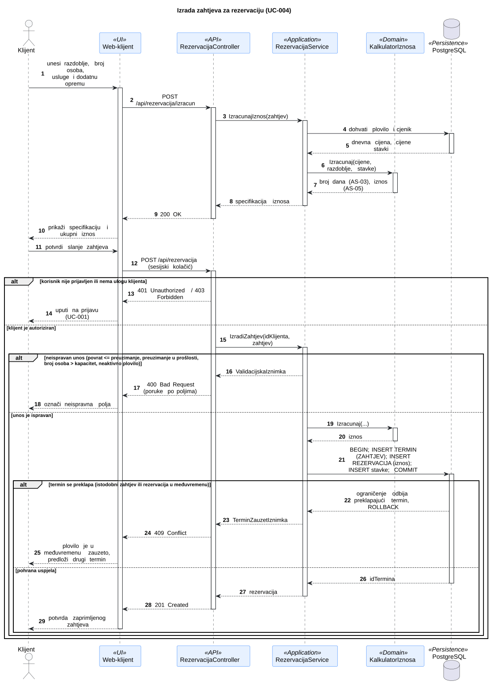
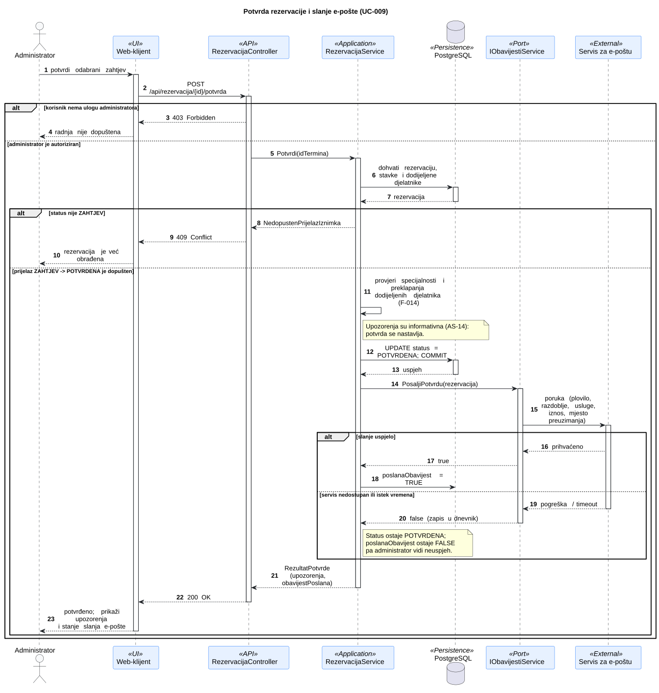
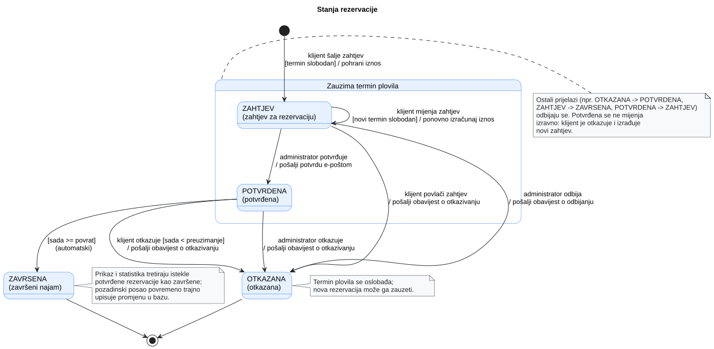

# 4. Arhitektura i oblikovanje

**Cilj:** Definirati arhitekturni stil, dekompoziciju programa na podsustave i module, organizaciju podataka te dinamičko ponašanje tijekom izvođenja. Arhitektura je temelj za implementaciju i ažurira se pri svakoj važnijoj promjeni projektnih odluka.

| Arhitekturni pogled | Ključno inženjersko pitanje | Primijenjeni model ili dijagram |
| :--- | :--- | :--- |
| **Strategija rješenja** | Koji stil i temeljne odluke određuju program? | Tablica odluka (4.1) i ADR-i (4.5) |
| **Struktura podsustava** | Koji su glavni dijelovi i kako komuniciraju? | Dijagram komponenata (slika 4.1) |
| **Model podataka** | Kako su strukturirani trajni podaci programa? | ER dijagram (slika 4.2) |
| **Struktura koda** | Kako su dodijeljene odgovornosti i ključne klase? | Dijagram razreda za rezervacije (slika 4.3) |
| **Dinamičko ponašanje** | Kako moduli surađuju pri obradi ključnih transakcija? | Sekvencijski dijagrami (slike 4.4 i 4.5) |
| **Stanja sustava** | Kako ključni domenski objekt mijenja svoja stanja? | Dijagram stanja rezervacije (slika 4.6) |
| **Fizički razmještaj** | Na kojim se izvršnim čvorovima program izvodi? | Dijagram razmještaja (poglavlje 6) |

---

## 4.1 Ključne arhitekturne odluke

| Odluka | Razmatrana alternativa | Obrazloženje i kompromis |
| --- | --- | --- |
| Web-klijent u pregledniku (React) i jedan poslužiteljski API (ASP.NET Core) | Poslužiteljski generirane stranice; više zasebnih usluga | Interaktivno i responzivno sučelje (pretraga, kalendar, karta, izračun iznosa), a poslovna pravila na jednom mjestu. Kvar poslužitelja zaustavlja cijeli sustav. ADR-01. |
| Preklapanje termina sprječava baza podataka | Provjera samo u aplikaciji | Pravilo vrijedi i pri istodobnim zahtjevima (F-008, NF-03). Sustav ovisi o mogućnostima PostgreSQL-a. ADR-02. |
| Rezervacije i razdoblja nedostupnosti bilježe se kao ista vrsta zapisa o zauzetosti plovila (termin) | Rezervacije i nedostupnosti potpuno odvojeno | Jedno pravilo o preklapanju pokriva i sukob rezervacije sa servisom plovila. Svaki upis rezervacije zahtijeva dva povezana zapisa. ADR-03. |
| Poslovna pravila u servisima i domenskim razredima, a ne u kontrolerima | Logika izravno u kontrolerima | Izračun iznosa i prijelazi statusa koriste se na više mjesta i moraju se moći ispitati izolirano. Cijena je veći broj razreda. |
| Iznos rezervacije računa poslužitelj i pohranjuje ga pri izradi | Izračun u pregledniku ili pri svakom prikazu | Klijent ne određuje cijenu, a promjena cjenika ne mijenja postojeće rezervacije. |
| Prijava putem AAI@EduHr, a uloge se vode u aplikaciji | Vlastite lozinke; uloge od pružatelja identiteta | Zadatak propisuje AAI@EduHr, a on ne poznaje uloge charter tvrtke. ADR-04. |
| Vanjski servisi iza sučelja; e-pošta se šalje nakon spremanja promjene | Slanje unutar iste transakcije | Kvar servisa ne smije poništiti promjenu statusa (NF-04). Ako slanje ne uspije, administrator to vidi i može ga ponoviti. |

## 4.2 Gradivni blokovi i UML dijagram komponenata

**Slika 4.1. Dijagram komponenata sustava za charter poslovanje**

**PlantUML izvor:** [izvor](./puml/4-1-charter-system-CMP.puml)

| Komponenta | Odgovornost | Razlog za ovu granicu |
| --- | --- | --- |
| Web-klijent | Prikazuje katalog, pretragu, detalje plovila s kartom i prognozom, rezervacije te sučelja za djelatnike, voditelja i administratora. | Korisnička interakcija odvojena je od poslovnih pravila; skrivanje elemenata sučelja nije zaštita. |
| REST API | Prima zahtjeve, provjerava ovlasti i vraća odgovore. | Ono što je izloženo prema van odvojeno je od pravila i pohrane. |
| Autentifikacija i autorizacija | Prijava putem AAI@EduHr, stvaranje računa pri prvoj prijavi, provjera uloge i aktivnosti računa. | Sigurnosno pravilo vrijedi za sve module i provodi se na jednom mjestu. |
| Katalog i pretraga | Plovila, detalji, kalendar zauzetosti i filtriranje s cijenom za razdoblje. | Javni dio sustava koji samo čita podatke. |
| Rezervacije | Izračun iznosa, provjera raspoloživosti, statusi i dodjela djelatnika. | Najvažnija poslovna pravila, ispitiva neovisno o ostatku sustava. |
| Upravljanje flotom i cjenikom | Plovila, luke, oprema, usluge, cijene i razdoblja nedostupnosti. | Administrativne izmjene odvojene su od rezervacija. |
| Korisnici i uloge | Dodjela uloga i specijalnosti, aktivacija i deaktivacija računa. | Upravljanje ovlastima odvojeno je od same provjere ovlasti. |
| Raspored | Potvrđena preuzimanja i povrati za odabrano razdoblje. | Pogled za djelatnike s vlastitim pravima pristupa. |
| Statistika i izvoz | Pokazatelji poslovanja i CSV izvještaj. | Samo čita i agregira podatke. |
| Obavijesti | Slanje e-pošte i bilježenje ishoda slanja. | Izolira ovisnost o vanjskom servisu i njegove kvarove. |
| Vremenska prognoza | Dohvat prognoze za matičnu luku i razdoblje. | Izolira ovisnost o vanjskom servisu. |
| Završetak najma | Istekle potvrđene rezervacije označava završenima. | Prijelaz ne pokreće korisnik nego protok vremena. |
| Pristup podacima i baza | Trajna pohrana i ograničenja integriteta. | Pravila u bazi vrijede neovisno o kodu koji upisuje podatke. |

**Analiza dijagrama:** Vanjska granica odvaja sustav od četiri vanjska servisa: AAI@EduHr, servisa za e-poštu, meteorološkog i kartografskog servisa. Moduli poslužiteljske aplikacije logičke su cjeline jedne aplikacije, a ne zasebno postavljene usluge. Kartu prikazuje web-klijent izravno, a prognozu dohvaća poslužitelj. Strelice prikazuju ovisnosti, a redoslijed obrade prikazuju sekvencijski dijagrami u odjeljku 4.4.

## 4.3 Model podataka i oblikovanje razreda

### 4.3.1 ER dijagram i model podataka

**Slika 4.2. ER dijagram sustava za charter poslovanje**

**PlantUML izvor:** [izvor](./puml/4-2-charter-data-ERD.puml)  
**Implementacija:** [`db/1-charter-database-setup.sql`](../db/1-charter-database-setup.sql)

**Primjer:** Klijentica Ana rezervira jedrilicu od 1. 7. u 10:00 do 4. 7. u 11:00 uz uslugu skipera i dvije SUP daske. Nastaje termin s plovilom, razdobljem i statusom „zahtjev” te rezervacija s iznosom i brojem osoba. Odabrane usluge i oprema vežu se uz rezervaciju zajedno s cijenom u trenutku izrade, a oprema i s količinom. Ako administrator za isto plovilo pokuša unijeti servis od 3. do 5. 7., baza odbija unos jer se termini preklapaju.

**Analiza modela:**

- **Termin** je zapis o tome da je plovilo zauzeto od jednog do drugog trenutka. Svaka rezervacija i svako razdoblje nedostupnosti ima svoj termin sa statusom (statusi rezervacije ili „nedostupan termin”), a njihovi posebni podaci (iznos, razlog nedostupnosti) nalaze se u zasebnim tablicama. Baza ne dopušta da se dva termina istog plovila preklapaju; otkazani termini se pri tome ne uzimaju u obzir, pa otkazivanje odmah oslobađa plovilo. Razdoblje je oblika [preuzimanje, povrat), pa nova rezervacija smije početi točno u trenutku povrata prethodne.
- **Luke, vrste plovila i proizvođači** vode se kao zasebni popisi u vlastitim tablicama, a plovilo na njih samo upućuje. Tako se svaki naziv upisuje samo jednom, a plovila se lako filtriraju po luci, vrsti ili proizvođaču. Luka uz naziv sadrži i koordinate potrebne za kartu i vremensku prognozu.
- **Korisnik** čuva samo podatke iz AAI@EduHr, ulogu i oznaku aktivnosti; lozinke se ne pohranjuju. Specijalnost djelatnika zapisuje se kao njegova uloga (skiper, mehaničar, kuhar, čistač), pa djelatnik uvijek ima točno jednu specijalnost.
- **Stavke rezervacije** (usluge i dodatna oprema) povezuju rezervaciju s katalogom i pamte cijenu u trenutku izrade, pa promjena cjenika ne mijenja postojeće rezervacije. Uz dodatnu opremu pamti se i količina.
- **Pravila u bazi:** uz zabranu preklapanja, baza ne dopušta da se na istu rezervaciju veže više od jednog klijenta (djelatnika može biti više) te provjerava da status termina odgovara njegovoj vrsti: samo razdoblje nedostupnosti ima status „nedostupan termin”.

### 4.3.2 Reprezentativni UML dijagram razreda

**Odabrano područje:** izrada rezervacije, izračun iznosa i promjene statusa. To je dio s najviše poslovnih pravila i najvećim rizikom pogreške.

**Slika 4.3. Dijagram razreda za izradu i obradu rezervacija**

**PlantUML izvor:** [izvor](./puml/4-3-charter-reservation-CD.puml)

**Analiza oblikovanja:**

- **Kontroler** samo prima zahtjeve i prosljeđuje ih servisu; u njemu nema poslovnih pravila.
- **Servis rezervacija** koordinira slučaj uporabe: učitava podatke, primjenjuje pravila, sprema promjene i zatim šalje obavijest.
- **Rezervacija** sama provodi dopuštene prijelaze statusa, pa nijedan dio sustava ne može npr. potvrditi otkazanu rezervaciju.
- **Razdoblje najma** i **kalkulator iznosa** računaju broj dana i iznos neovisno o bazi, pa se lako ispituju.
- **Sučelje za obavijesti** odvaja servis od konkretnog pružatelja e-pošte, pa se pružatelj može zamijeniti, a u ispitivanju simulirati kvar.

## 4.4 Ponašanje tijekom izvođenja

### 4.4.1 Reprezentativni UML sekvencijski dijagrami

**Scenarij 1:** Izrada zahtjeva za rezervaciju (UC-004)

**Slika 4.4. Sekvencijski dijagram izrade zahtjeva za rezervaciju**

**PlantUML izvor:** [izvor](./puml/4-4-charter-reservation-request-SD.puml)

**Analiza:** Klijent prije slanja vidi iznos koji izračunava poslužitelj. Pri slanju poslužitelj ponovno provjerava prijavu i ispravnost unosa, a zatim termin, rezervaciju i stavke sprema zajedno: ili se spremi sve ili ništa. Ako je drugi klijent u međuvremenu zauzeo isti termin, baza odbija upis, a klijent dobiva poruku da plovilo više nije slobodno. Provjera u aplikaciji služi za ranu poruku korisniku, a jamstvo protiv dvostruke rezervacije daje baza.

**Scenarij 2:** Potvrda rezervacije i slanje e-pošte (UC-009)

**Slika 4.5. Sekvencijski dijagram potvrde rezervacije**

**PlantUML izvor:** [izvor](./puml/4-4-charter-reservation-confirmation-SD.puml)

**Analiza:**

- Potvrdu smije izvesti samo administrator, i to samo za rezervaciju u statusu „zahtjev”.
- Upozorenja o djelatnicima (neodgovarajuća specijalnost ili preklapanje s drugim najmom) informativna su i ne zaustavljaju potvrdu.
- E-pošta se šalje tek nakon spremanja potvrde. Ako slanje ne uspije, potvrda ostaje važeća, a administrator vidi da obavijest nije poslana.

### 4.4.2 Reprezentativni UML dijagram stanja

**Vlasnik stanja i razlog odabira:** Odabrana je rezervacija. Njezin status određuje zauzima li ona termin plovila, tko smije izvesti promjenu i kada se klijentu šalje e-pošta.

**Slika 4.6. Dijagram stanja rezervacije**

**PlantUML izvor:** [izvor](./puml/4-5-charter-reservation-SM.puml)

**Analiza:**

- „Zahtjev” i „potvrđena” zauzimaju termin, a otkazivanje ga oslobađa.
- Klijent može mijenjati samo zahtjev. Potvrđenu rezervaciju otkazuje do početka najma i izrađuje novu.
- Potvrđena rezervacija automatski postaje „završeni najam” kada prođe vrijeme povrata.
- „Otkazana” i „završeni najam” su završna stanja; ostali prijelazi se odbijaju.

## 4.5 Zapisi arhitekturnih odluka

### ADR-01: Web-klijent i jedan poslužiteljski API

| Polje | Zapis odluke |
| --- | --- |
| Kontekst i cilj | Tim od sedam članova u jednom semestru izrađuje aplikaciju s javnim katalogom, rezervacijama i administracijom za četiri uloge, uz responzivno sučelje. |
| Kriteriji odluke | Paralelan rad na sučelju i poslužitelju; poslovna pravila na jednom mjestu; izvedivost postavljanja. |
| Razmatrane alternative | **Poslužiteljski generirane stranice:** jednostavnije, ali slabija interaktivnost. **Više zasebnih usluga:** neovisno postavljanje, ali nepotrebno složeno za ovaj opseg. |
| Odluka i obrazloženje | Sučelje je zasebna React aplikacija, a sva poslovna logika nalazi se u jednom ASP.NET Core API-ju podijeljenom na module. Tako dio tima može raditi na sučelju, a dio na poslužitelju, uz jasno dogovorene rute API-ja. |
| Status | Prihvaćeno. |

### ADR-02: Sprječavanje preklapanja u bazi podataka

| Polje | Zapis odluke |
| --- | --- |
| Kontekst i cilj | Dvostruka rezervacija glavni je problem koji aplikacija rješava. Pravilo mora vrijediti i pri istodobnim zahtjevima (F-008, NF-03). |
| Kriteriji odluke | Ispravnost pri istodobnom radu; neovisnost o tome koji dio koda upisuje termin. |
| Razmatrane alternative | **Provjera u aplikaciji:** između provjere i upisa drugi zahtjev može zauzeti isti termin. **Ograničenje u bazi:** baza odbija svaki preklapajući upis. |
| Odluka i obrazloženje | Preklapanje termina istog plovila zabranjeno je ograničenjem u samoj bazi. Čak i kad dva klijenta u istoj sekundi pošalju zahtjev za isto plovilo, uspjet će samo jedan. Aplikacija raspoloživost provjerava i prije upisa, ali samo zato da korisnik dobije razumljivu poruku. Rješenje se oslanja na mogućnost specifičnu za PostgreSQL, pa promjena baze nije jednostavna. |
| Status | Prihvaćeno. |

### ADR-03: Rezervacije i nedostupnosti kao zajednički termin

| Polje | Zapis odluke |
| --- | --- |
| Kontekst i cilj | Plovilo je zauzeto kada je rezervirano, ali i kada je na servisu ili održavanju. Ni ta se razdoblja ne smiju preklapati s rezervacijama (F-018). |
| Kriteriji odluke | Jedno mjesto provjere preklapanja; jednostavan prikaz kalendara zauzetosti. |
| Razmatrane alternative | **Odvojene tablice za rezervacije i nedostupnosti:** baza bi sprječavala preklapanje samo unutar svake tablice, a sukob rezervacije i servisa morala bi provjeravati aplikacija. **Zajednička tablica termina:** svako zauzeće plovila, bilo rezervacija ili nedostupnost, upisuje se kao termin (plovilo, početak, kraj), a dodatni podaci u svoju tablicu. |
| Odluka i obrazloženje | Svako zauzeće plovila upisuje se kao termin. Termin nosi status, rezervacija uz njega ima iznos i stavke, a nedostupnost razlog. Zabrana preklapanja definirana je samo nad terminima, pa automatski vrijedi i između rezervacija i servisa, a kalendar zauzetosti čita jednu tablicu. Nedostatak je što se rezervacija sprema kao dva povezana zapisa koji se moraju upisati zajedno. |
| Status | Prihvaćeno. |

### ADR-04: Prijava putem AAI@EduHr i uloge u aplikaciji

| Polje | Zapis odluke |
| --- | --- |
| Kontekst i cilj | Zadatak propisuje prijavu putem AAI@EduHr (C-01), a uloge i specijalnosti korisnika određuje administrator. |
| Kriteriji odluke | Bez pohrane lozinki; provjera uloge i aktivnosti računa na poslužitelju. |
| Razmatrane alternative | **Uloge od pružatelja identiteta:** AAI@EduHr ne poznaje uloge charter tvrtke. **Uloge u aplikaciji:** potpuna kontrola, ali račun nastaje tek pri prvoj prijavi. |
| Odluka i obrazloženje | AAI@EduHr služi samo za potvrdu identiteta. Pri prvoj prijavi aplikacija stvara račun s ulogom klijenta, a ostale uloge i specijalnosti dodjeljuje administrator. Promjena uloge ili deaktivacija računa vrijedi već od sljedećeg zahtjeva, jer poslužitelj ulogu provjerava pri svakom zahtjevu. |
| Status | Prihvaćeno. |

## 4.6 Zajednička pravila oblikovanja (engl. *Cross-cutting concerns*)

| Aspekt | Mehanizam | Pravilo | Mjesto primjene |
| --- | --- | --- | --- |
| Sigurnost | Autorizacija prema ulozi i vlasništvu | Ovlasti se provjeravaju na poslužitelju za svaki zaštićeni zahtjev; klijent vidi samo svoje rezervacije (NF-02). | API i servisi |
| Validacija podataka | Provjera u sučelju, na poslužitelju i u bazi | Sučelje provjerava oblik unosa (obavezna polja, format datuma i brojeva) radi brze povratne informacije. Poslužitelj ponovno provjerava sve ulaze, jer se provjeri u pregledniku ne može vjerovati, a ograničenja u bazi zadnja su zaštita. | Web-klijent, servisi, baza podataka |
| Konzistentnost | Transakcije | Termin, rezervacija i stavke spremaju se zajedno ili se ne spremaju uopće. | Servis rezervacija |
| Vrijeme | Lokalno vrijeme | Vremena se tumače kao lokalno vrijeme Europe/Zagreb, bez vremenske zone. | Cijeli sustav |
| Otpornost na kvarove | Zamjenski prikaz | Kvar vanjskog servisa prikazuje obavijest, a ostale funkcionalnosti rade; neuspjelo slanje e-pošte se bilježi (NF-04). | Obavijesti, prognoza, karta |
| Zaštita osobnih podataka | Ograničeni prikaz podataka | Javni kalendar ne otkriva podatke klijenata; svaka uloga dobiva samo podatke koji su joj potrebni. | API |
| Upravljanje ovisnostima | Injektiranje ovisnosti | Servisi primaju bazu i vanjske servise izvana, pa se u ispitivanju mogu zamijeniti. | Poslužiteljska aplikacija |

## 4.7 Arhitekturni rizici i tehnički dug

**Tehnički rizici i dug**

| Rizik ili kompromis | Posljedica | Odgovor na rizik |
| --- | --- | --- |
| Dan najma kao 24-satno razdoblje u lokalnom vremenu | Pri prijelazu na ljetno ili zimsko vrijeme najam stvarno traje sat dulje ili kraće. | Prihvaćeno pojednostavljenje. |
| Nema automatskih testova | Pogreške u pravilima rezerviranja ne otkrivaju se automatski. | Plan ispitivanja u poglavlju 5. |

**Poslovni ili domenski rizici**

| Rizik | Posljedica | Odgovor na rizik |
| --- | --- | --- |
| **Neobrađeni zahtjev blokira termin** | Zahtjev ne istječe automatski, pa drugi klijenti ne mogu rezervirati plovilo. | Administrator pregledava zahtjeve na čekanju. |
| **Jedna instanca aplikacije** | Kvar poslužitelja privremeno onemogućuje rezervacije. | Prihvaćeno u okviru projekta. |
| **Ovisnost o AAI@EduHr** | Bez pružatelja identiteta nije moguća prijava ni ispitivanje uloga. | Pravodobno osigurati testne identitete. |
| **Neuspjelo slanje e-pošte** | Klijent ne zna da je rezervacija potvrđena ili otkazana. | Status ostaje važeći, a administrator vidi neuspjeh i može ponoviti slanje. |
| **Ograničenja besplatnih vanjskih servisa** | Karta ili prognoza mogu prestati raditi. | Umjesto podataka prikazuje se obavijest. |

---

> **Završna provjera:** Pri svakoj iteraciji usporediti dijagrame s implementiranim kodom i stvarnim ponašanjem aplikacije te ažurirati zastarjele opise.
